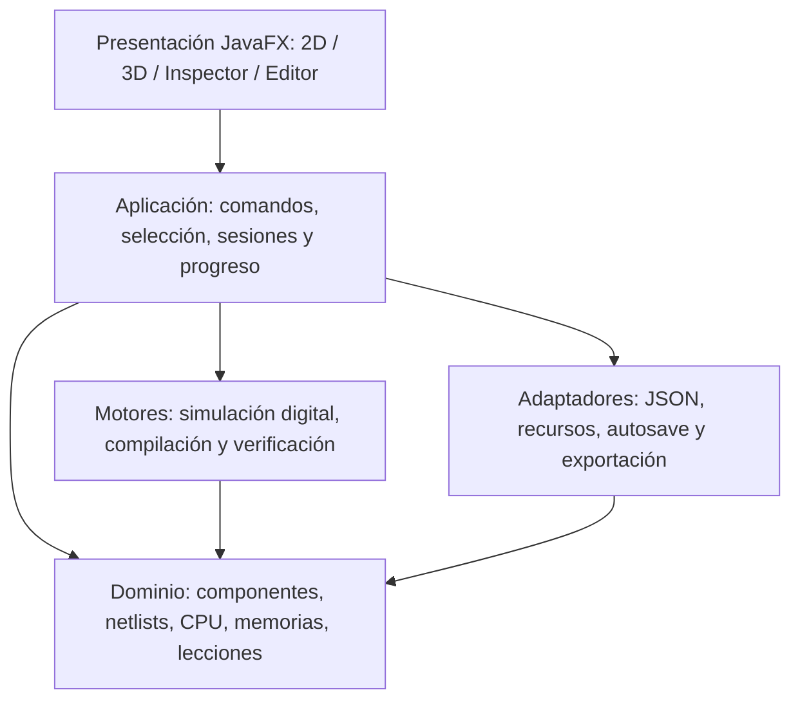

# Aula-Computadora — arquitectura de software y contrato de vistas

**Versión:** propuesta V1, noviembre de 2026  
**Objeto:** preproducción de la aplicación Java 21/JavaFX; aún no es código integrado, ni designa circuitos físicamente certificados.  
**Ámbito:** específico de Aula-8/Aula-16. No sustituye el futuro manual general «Arquitectura de experiencia UX/UI y definición funcional del producto».

## 1. Decisiones de producto ratificadas por Marcos

| Clave | Decisión confirmada | Consecuencia de software |
|---|---|---|
| UX-01 | La máquina completamente montada se puede explorar **desde el inicio** como demostración independiente del progreso. | `Explorar` abre un estado de ejemplo sin contaminar los checkpoints del recorrido `Construir`. La demo es de lectura/pruebas, no un CAD abierto. |
| UX-02 | Cada recorrido, Aula-8 y Aula-16, debe poder completarse en aproximadamente **cinco horas o menos de uso continuo**. «Terminar» incluye montaje guiado, pruebas y ejecutar un programa sencillo con resultado visible. | Las prácticas avanzadas de programación —ensamblador nativo, utilidades o MiniC— pueden seguir después del hito de construcción, sin borrar el compromiso de implementarlas en el producto. Hay que medir duración real. |
| UX-03 | La vista 3D de Aula-8 será una **placa didáctica original**, no un circuito impreso listo para fabricar. | La geometría enseña ubicación y relaciones; un nivel físico fabricable se considera otro proyecto que requiere BOM, huellas, pinouts y verificaciones. |
| UX-04 | **Aula-8** tiene esquemas 2D y placa 3D; **Aula-16** es 2D en V1, pero una vista 3D futura no debe exigir reescribir el motor. | Capacidades de vista declaradas por perfil de máquina, no dispersas en comprobaciones `if (aula8)` ni incrustadas en el motor. |

Estas resoluciones aclaran D-007 (explorar + construir) sin eliminar el modo de exploración. Mantener el repositorio documental y la evolución editorial separados de cualquier implementación que no se haya pedido.

## 2. Principio central: el transistor **no es** su dibujo

El mismo transistor del circuito puede aparecer en un esquema como símbolo eléctrico, en 3D como encapsulado didáctico, en el inspector como ficha, y en una tabla como lista de terminales. Pero **su comportamiento y sus conexiones existen una sola vez**.

Separar formalmente:

- **`ComponentDefinition`**: el tipo de pieza; define terminales y modelo de comportamiento. Solo incluir modelos necesarios en los desafíos. No exigir que toda definición sea una subclase Java: para MOS, NAND, registro, SRAM, etc. puede usarse una taxonomía pequeña y composición de definiciones.
- **`ComponentInstance`**: la pieza concreta de ese tipo, con ID estable y pertenencia a un circuito. Dos MOSFET del mismo modelo son instancias distintas.
- **`Pin` / `Net`**: terminales y conexiones del netlist. La unión de terminales no se deduce de que dos figuras estén cerca o compartan coordenadas.
- **`SimulationSnapshot`**: los estados observables en un instante: señales `0/1/X/Z`, reloj, memoria, registros y, si hay modelo para ello, conducción de cada transistor.
- **`VisualSpec`**: metadatos de presentación que enlazan `typeId` con representación 2D, 3D, etiquetas, color, terminales visuales y niveles de detalle. Puede faltar el modelo 3D sin invalidar la pieza.
- **`ViewSelection`**: ID/ruta del componente seleccionado. Inspector, esquema y placa traducen esa identidad a sus propias figuras, no comparten un `Node` JavaFX.

Por tanto, **evitar** `class Transistor { javafx.scene.shape.Shape shape2D; javafx.scene.shape3d.MeshView shape3D; ... }`. Eso produciría acoplamiento, dificultaría pruebas y obligaría a cargar JavaFX para trabajar con un circuito digital.

En cambio, una representación ilustrativa sería:

```java
// Boceto de interfaces, NO API implementada ni contrato de serialización.
record ComponentId(String hierarchicalPath) {}
record ComponentInstance(ComponentId id, String definitionId) {}

record VisualSpec(
    String componentDefinitionId,
    String symbol2dId,
    String model3dId // opcional; ausente en máquinas sin 3D
) {}

interface CircuitRenderer {
    void show(CircuitReadModel circuit, SimulationSnapshot state);
    void highlight(ComponentId selected);
}

interface Renderer2D extends CircuitRenderer {}
interface Renderer3D extends CircuitRenderer {}
```

La identidad jerárquica debe distinguir, por ejemplo, las ocho copias lógicas de un elemento repetido (`/alu/bit3/...`) sin confundir el ID **de tipo** con el ID **de instancia**. Las anclas gráficas de los pines son metadatos de vista; su correspondencia con pines del dominio se verifica al cargar recursos.

## 3. Capas y dirección de dependencias



**Regla de dependencia:** dominio, lógica y pruebas ejecutan sin módulos JavaFX, incluso sin ventana gráfica; presentación importa contratos de aplicación, nunca a la inversa. La simplificación técnica es un **monolito modular Java 21 + Maven**, como `ARQUITECTURA_SOFTWARE.md`, con paquetes claros antes de crear múltiples JAR o servicios.

### Responsabilidades propuestas

| Paquete conceptual | Qué contiene | Qué no debe contener |
|---|---|---|
| `dominio` / `circuitos` | Definiciones, instancias, pines, nets, módulos, jerarquía, IDs | Nodos de JavaFX, CSS o coordenadas como semántica eléctrica |
| `logica` / `cpu` / `memoria` | Máquina de estados, propagación y resolución digital, reloj, buses, RAM/ROM/MMIO | Mensajes didácticos, colores, inspector |
| `ensamblador` / `minic` | Herramientas cruzadas del anfitrión, formato de instrucciones, errores de traducción | Hacer pasar el ensamblador Java por ensamblador nativo de Aula |
| `lecciones` | Recorridos, piezas permitidas, estado de montaje, pistas, pruebas y conclusión | Reimplementar puertas NAND con condiciones específicas de UI |
| `aplicacion` | Comandos `place`, `test`, `tick`, `load`, `run`, selección, autosave, versión de sesión | Deducir electricidad de gestos del ratón |
| `interfaz` | `MainWindow`, adaptadores `Renderer2D/3D`, inspector, panel de problemas, controles de programa | Ser fuente autoritativa de la memoria o de la ALU |
| `recursos` / `persistencia` | Lectura de especificaciones, sprites/símbolos SVG si proceden, geometría, escenarios y progreso versionado | Formatos binarios no aprobados usados como definitivos |

En implementación se pueden preservar los nombres de paquetes del repositorio y **añadir** `aplicacion`/`persistencia` donde haga falta; esta tabla no exige renombrar carpetas existentes.

## 4. Un modelo, tres maneras de verlo

| Elemento del dominio | Esquema 2D | Placa didáctica 3D | Inspector |
|---|---|---|---|
| MOSFET definido para desafío NAND | Símbolo con terminales etiquetados | Encapsulado/representación reconocible | Modelo exacto usado, terminales, función y conducción simulada |
| NAND2 de cuatro MOS | Puerta NAND en nivel resumido; despiece al entrar | Chip/módulo, si aplica al desafío | Tabla de verdad, entradas, salida y prueba |
| Registro de 8 bits | Ocho líneas más CLK/LOAD y estado binario | Módulo colocado en placa | `10100110`, reloj, entradas habilitadas y pruebas |
| ALU8 de 359 NAND | Símbolo resumido, bit 0, red expandible por demanda | Bloque funcional del sistema, **no** 359 chips ficticios | Operación y señales observadas; profundidad de detalle seleccionable |
| RAM / ROM | Bloque + buses + visor de direcciones | Encapsulado o banco ilustrativo | Dirección, byte/palabra, lectura/escritura y limitaciones |
| Pantalla | Periférico MMIO + señales | Monitor didáctico único | Modo texto/gráficos, dimensiones y buffer representado |

La redacción «transistor activado = 1 lógico» se deberá matizar: **conducción del transistor** y **valor lógico de un nodo** son magnitudes distintas. Es aceptable iluminar la pieza como recurso educativo, pero el inspector debe expresar cuál de las dos se está mostrando.

### Tecnologías gráficas propuestas, sin comprometer versión exacta de JavaFX

- **2D general:** `Pane` con `Line`, `Path`, `Text` y formas para elementos con interacción individual. Para redes extensas como la ALU, una representación híbrida con `Canvas` y un índice de selección por coordenadas evita miles de nodos; se usa zoom y despiece jerárquico. El `Canvas` dibuja por `GraphicsContext`, pero no proporciona por sí mismo un nodo individual para cada puerta.
- **3D Aula-8:** `SubScene` con cámara, escena tridimensional y geometría reutilizable (`Box`, `Cylinder`, mallas solo donde aportan); picking por instancia y distinción clara de arrastrar piezas frente a mover cámara. La escena 3D se puede incrustar en la ventana principal.
- **Inspector/UX:** controles nativos `MenuBar`, `ToolBar`, `TabPane`, `SplitPane`, panel de estado y CSS austero inspirado en ReconcileLab. Paneles plegables y ajustables de tamaño.
- **Concurrencia:** el motor produce instantáneas sin tocar nodos JavaFX; la aplicación entrega actualizaciones a la interfaz en el hilo de JavaFX y puede agrupar cambios visuales para mantener fluidez. La velocidad de dibujo **no modifica** la cantidad ni el orden de pasos lógicos ejecutados.

Lo anterior se apoya en la API documentada de OpenJFX para `SubScene`, `Canvas`, `Platform` y `SplitPane`. No se ha probado todavía compatibilidad/rendimiento en la laptop del autor.

## 5. Ejemplo completo de una interacción: colocar y probar una NAND

1. La paleta presenta la definición de pieza autorizada y su ilustración, sin instanciar un componente de dominio hasta soltarla.
2. El alumno arrastra al hueco `slot_03`. Un adaptador visual calcula dónde dibujarla y la capa de aplicación verifica si la posición es **admisible**. Esto no implica que el montaje esté **correcto**.
3. Al soltar, el comando crea/modifica `ComponentInstance` con ID estable y registra la vinculación didáctica. La conectividad real se define por un mapeo explícito de pines y nets, no solo por coordenadas de contacto.
4. Los renderizadores 2D/3D refrescan la misma instancia; el inspector puede mostrar su definición, terminales y estado. Undo/redo afectan al modelo de montaje.
5. Al probar, el verificador comprueba reglas estructurales y la tabla de verdad. Si hay `A=1`, `B=1`, `Y=1` cuando se esperaba `Y=0`, mostrar la discrepancia. Solo señalar «esta entrada está invertida» si el test de cableado **demuestra** esa causa.
6. Tras superar las pruebas exigidas, la lección marca la NAND como unidad semántica reutilizable; la siguiente actividad no exige repetir todas sus piezas si no aporta aprendizaje.

**Estados independientes:** componente seleccionado / pieza colocada / montaje evaluable / prueba aprobada / reloj andando / avance guardado. Ninguno se deduce del color de otra vista.

## 6. Compartir modelos entre libro y aplicación

La equivalencia buscada no significa exportar una captura JavaFX al PDF como única fuente. Definir un **contrato de geometría/diagrama** alimentado por las IDs del netlist:

- El libro emplea SVG/PNG exactos y editables, cuando se necesitan, con un generador y transformaciones de maquetación.
- El visor 2D dibuja con primitivas o gráficos vectoriales basados en la **misma topología y nombres de señales**.
- El 3D transforma referencias de componente a geometrías escénicas, manteniendo pines y relaciones identificables.
- La exportación de una figura para el libro no copia estados/gestos de la UI ni impone a los libros las convenciones de una aplicación de escritorio.

En C28-AD, `modelo_compartido_libro_app.json` ya es un buen **puente inicial** con nueve módulos y 61 trazas; todavía no es un netlist completo de CPU y no debe sustituir `Aula8_ALU359_APP_NETLIST.json` o el RTL C28-W. Es necesario versionar los archivos, validar IDs y evitar que una actualización visual invente un bus inexistente.

## 7. Capacidad futura de Aula-16 3D sin deuda masiva

La arquitectura debe representar una lista de capacidades por máquina, por ejemplo:

```text
Aula-8:  availableViews = [SCHEMATIC_2D, BOARD_3D, PROGRAM]
Aula-16: availableViews = [SCHEMATIC_2D, PROGRAM]
```

La lista configura pestañas y comandos disponibles. Agregar `BOARD_3D` a Aula-16 en otra versión significaría crear su `VisualSpec`/layouts y renderizador de esa máquina, **no** cambiar `Net`, `CpuState`, el compilador, la ISA ni cada transistor. Esta es una meta de desacoplamiento, no una promesa de que diseñar la placa 3D de Aula-16 sería trivial.

**No crear** una jerarquía de clases `Aula8Transistor3D`, `Aula16Transistor2D`, `Aula16Transistor3D`. El tipo y la instancia de pieza son independientes de la máquina y del medio; el layout visual depende del escenario y del nivel de detalle.

## 8. Persistencia y pruebas mínimas

- Guardar por recorrido: arquitectura (`AULA8` o `AULA16`), versión de especificación, etapa, piezas colocadas, pruebas aprobadas, pistas y preferencias de paneles. Separar estado didáctico persistente de memoria volátil de una sesión de CPU.
- Los cambios estructurales solo se aplican en estados seguros; decidir explícitamente si se permite editar con CPU pausada, en lugar de introducir cambios invisibles mientras corre.
- `JUnit`: misma instancia visible por ambos renderizadores; un cable mal conectado no aprueba tabla de verdad; 3D opcional sin romper 2D; renderers sin mutar netlist; memoria y estado deterministas después de `tick`; save/load de lección versionado; editor externo ≠ binario nativo Aula.
- Comparar CPU digital y **modelo de referencia semántica independiente** al límite de cada instrucción, según `ARQUITECTURA_SOFTWARE.md`, una vez que exista ISA ejecutable.
- Prueba manual de la meta de cinco horas por arquitectura, con registro del número de acciones repetitivas y pasos difíciles; no convertir el supuesto temporal en estadística inventada.

## 9. Decisiones de arquitectura y prioridad

| ID | Estado | Decisión/pendiente |
|---|---|---|
| SW-01 | **DISEÑO BASE recomendado** | `ComponentDefinition`/`ComponentInstance`/`Pin`/`Net` no importan JavaFX; `VisualSpec` opcional se resuelve fuera del dominio. |
| SW-02 | **DISEÑO BASE recomendado** | Una sola simulación y selección alimentan 2D, 3D, inspector y paneles, por instantáneas coherentes. |
| SW-03 | **DISEÑO BASE recomendado** | Arquitecturas habilitan vistas mediante perfiles/capacidades; Aula-16 no necesita 3D en V1. |
| SW-04 | **DISEÑO BASE recomendado** | Montaje guiado y simulación sin interfaz son módulos separados, con errores explicados según evidencia. |
| SW-05 | **CONFIRMADO en repo** | Java 21, Maven, JavaFX y JUnit, inicialmente monolito modular y aplicación local. |
| SW-06 | **PENDIENTE de ingeniería** | Detalle de la interfaz del motor digital, reglas de reloj/X/Z, propagación, snapshot y pruebas de regresión. |
| SW-07 | **PENDIENTE de ingeniería** | Integración de modelos C28-AC/AD y cierre de las ISA/CPU sin crear una segunda arquitectura paralela solo para UI. |
| SW-08 | **PENDIENTE de UX** | Gestos precisos de drag/snap, elección de vistas jerárquicas, comportamiento de «Explorar», paso entre simulación y edición. |

### Próximo hito recomendado

Redactar un **contrato ejecutable mínimo** sobre NAND2: definición de pieza, instancia, pines/nets, simulación de sus cuatro **combinaciones de entrada** (00, 01, 10, 11), `VisualSpec` con símbolo 2D y presencia 3D conceptual, selección única, feedback veraz. Probar primero esa vertical con datos reales antes de construir la ventana completa o añadir funcionalidades genéricas.

Luego definir exactamente los **casos de uso** del `MenuBar`, `ToolBar`, `Inspector`, dock inferior y `StatusBar` por estado (montando, probando, ejecutando, programando, explorando). Con esos contratos sí conviene producir capturas fidedignas.

## 10. Referencias de alineación

- Repositorio documental Aula-Computadora: `simulador-javafx/MODELO_CIRCUITOS.md`, `ARQUITECTURA_SOFTWARE.md`, `ESPECIFICACION_FUNCIONAL.md`, `CONTRATO_VIDEO_AULA_V1.md`, además de `AGENTS.md` y `DECISIONES.md`.
- Entregables técnicos C28-AC (netlist ALU359, SVG NAND2, RTL C28-W) y C28-AD (modelo compartido, placa conceptual y auditoría de dos vistas).
- Contratos de experiencia elaborados: `UX_CONTRATO_AULA_C28AD_V1.md` y `MATRIZ_ALINEACION_AULA_8_16_UX_Y_REPOS_V1.md`.
- Documentación pública de OpenJFX: `https://openjfx.io/javadoc/27/javafx.graphics/javafx/scene/SubScene.html`, `https://openjfx.io/javadoc/27/javafx.graphics/javafx/scene/canvas/Canvas.html`, `https://openjfx.io/javadoc/27/javafx.graphics/javafx/application/Platform.html`, `https://openjfx.io/javadoc/27/javafx.controls/javafx/scene/control/SplitPane.html`.

**Importante:** este es un diseño de arquitectura, no autorización para cambiar silenciosamente decisiones `CONFIRMADO`, construir prematuramente el simulador o declararlo terminado.
