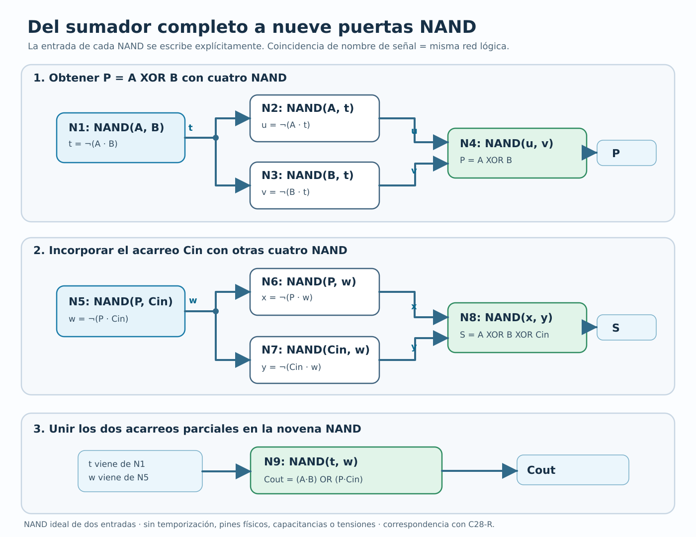
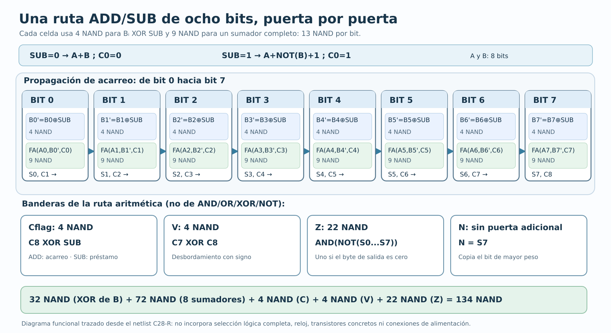

# Suplemento C28-T · Del sumador de un bit a 134 NAND

*Material complementario para los capítulos 4, 10 y 11 de Aula-Computadora.*

El capítulo 4 nos enseñó una idea poderosa: si conocemos el funcionamiento de
la puerta NAND, podemos combinar varias puertas para obtener otras funciones
lógicas. El capítulo 10 tomó esa idea y construyó un sumador. En el 11
reutilizamos el sumador para restar. Este suplemento reúne esos tres escalones:
seguiremos **las conexiones concretas** de un sumador de un bit y veremos cómo
se repite ocho veces para tratar dos bytes.

Nuestro objetivo no consiste en aprender una lista de nombres de compuertas
de memoria, sino en responder tres preguntas a cada paso: ¿de dónde llega
cada señal?, ¿qué operación ejecuta esta pieza?, ¿a qué pieza alimenta
después? Al terminar podremos seguir sobre el papel una ruta aritmética
de **134 NAND de dos entradas**, sin confundir ese resultado lógico con una
placa física ya construida.

## 1. De una puerta NAND a una suma

Una puerta NAND recibe dos valores binarios `X` e `Y` y entrega el contrario
de su operación AND. En nuestra notación escribiremos:

`NAND(X,Y) = NOT(X AND Y)`.

La salida solo vale cero cuando ambas entradas valen uno:

| X | Y | AND(X,Y) | NAND(X,Y) |
| --- | --- | --- | --- |
| 0 | 0 | 0 | 1 |
| 0 | 1 | 0 | 1 |
| 1 | 0 | 0 | 1 |
| 1 | 1 | 1 | 0 |

No pensemos en una puerta como un pequeño ordenador que conoce números:
solamente responde a dos niveles lógicos. El valor de un número de ocho
bits aparecerá porque **ocho grupos de puertas** cooperan, uno por cada
posición de peso 1, 2, 4, 8, 16, 32, 64 y 128.

## 2. Nueve NAND bastan para un sumador completo de un bit

Un sumador completo recibe `A`, `B` y un **acarreo entrante**, al que
llamamos `Cin`. Su salida `S` es el bit que queda en esa columna; `Cout`
es el acarreo que debe recibir la columna siguiente. Las ocho situaciones
posibles son:

| A | B | Cin | S | Cout | Comprobación |
| --- | --- | --- | --- | --- | --- |
| 0 | 0 | 0 | 0 | 0 | 0 = 0 + 2×0 |
| 0 | 0 | 1 | 1 | 0 | 1 = 1 + 2×0 |
| 0 | 1 | 0 | 1 | 0 | 1 = 1 + 2×0 |
| 0 | 1 | 1 | 0 | 1 | 2 = 0 + 2×1 |
| 1 | 0 | 0 | 1 | 0 | 1 = 1 + 2×0 |
| 1 | 0 | 1 | 0 | 1 | 2 = 0 + 2×1 |
| 1 | 1 | 0 | 0 | 1 | 2 = 0 + 2×1 |
| 1 | 1 | 1 | 1 | 1 | 3 = 1 + 2×1 |

Una forma de construir esta tabla utiliza **nueve NAND**. No hay ninguna
puerta misteriosa adicional: la figura siguiente muestra las nueve y
el nombre que recibe cada señal que producen.

Sus conexiones se pueden reproducir por escrito:

| Puerta | Entradas | Señal de salida | Para qué sirve |
| --- | --- | --- | --- |
| N1 | A, B | `t = NAND(A,B)` | Primera señal común a XOR y acarreo |
| N2 | A, t | `u = NAND(A,t)` | Primera rama de la XOR |
| N3 | B, t | `v = NAND(B,t)` | Segunda rama de la XOR |
| N4 | u, v | `P = NAND(u,v)` | Suma parcial `A XOR B` |
| N5 | P, Cin | `w = NAND(P,Cin)` | Detecta acarreo parcial de P y Cin |
| N6 | P, w | `x = NAND(P,w)` | Primera rama de la segunda XOR |
| N7 | Cin, w | `y = NAND(Cin,w)` | Segunda rama de la segunda XOR |
| N8 | x, y | `S = NAND(x,y)` | Bit de suma definitiva |
| N9 | t, w | `Cout = NAND(t,w)` | Acarreo que sale hacia la columna superior |

Observa las dependencias: `t` sale de N1 y entra en N2, N3 **y N9**.
`w` sale de N5 y entra en N6, N7 **y N9**. En el diagrama, cuando una señal
reaparece con el mismo nombre es la misma red lógica, aunque no dibujemos
un cable físico kilométrico entre los paneles. Los nombres permiten
reconstruir sin ambigüedad los dos terminales de cada NAND.

### Un ejemplo completamente trazado

Tomemos `A=1`, `B=0` y `Cin=1`. La suma de la columna debe valer
`1+0+1=2`, por lo que esperamos escribir `S=0` y transportar `Cout=1`.

1. N1: `t=NAND(1,0)=1`.
2. N2: `u=NAND(1,1)=0`.
3. N3: `v=NAND(0,1)=1`.
4. N4: `P=NAND(0,1)=1`.
5. N5: `w=NAND(1,1)=0`.
6. N6: `x=NAND(1,0)=1`.
7. N7: `y=NAND(1,0)=1`.
8. N8: `S=NAND(1,1)=0`.
9. N9: `Cout=NAND(1,0)=1`.

La respuesta coincide con la tabla. Es importante notar que el orden de
esta lista sirve **para explicar dependencias**, no significa que un
circuito físico tarde nueve ciclos de reloj. Las NAND se propagan señales
con tiempos eléctricos propios, todavía no medidos aquí.

## 3. De un bit a un byte: ocho sumadores conectados

Para sumar `A=00001101₂` (13) con `B=00001001₂` (9), usamos un sumador
de nueve NAND en cada posición `i=0...7`. El acarreo entrante del bit 0
es `C0=0`. El `Cout` del bit 0 se llama `C1` y alimenta el `Cin` del
bit 1; continuamos hasta `C8`.

Las ocho etapas **no son ocho operaciones independientes**: la etapa
superior puede tener que esperar a que el acarreo de las inferiores llegue
a un valor estable. Un cable llamado `C4` representa el mismo bit tanto
al salir de la etapa 3 como al entrar a la etapa 4.

| Bit | Ai | Bi | Acarreo recibido | Si | Acarreo entregado |
| ---: | ---: | ---: | ---: | ---: | ---: |
| 0 | 1 | 1 | C0=0 | 0 | C1=1 |
| 1 | 0 | 0 | C1=1 | 1 | C2=0 |
| 2 | 1 | 0 | C2=0 | 1 | C3=0 |
| 3 | 1 | 1 | C3=0 | 0 | C4=1 |
| 4 | 0 | 0 | C4=1 | 1 | C5=0 |
| 5 | 0 | 0 | C5=0 | 0 | C6=0 |
| 6 | 0 | 0 | C6=0 | 0 | C7=0 |
| 7 | 0 | 0 | C7=0 | 0 | C8=0 |

Leyendo de bit 7 a bit 0 aparece `00010110₂ = 0x16 = 22`. La suma
tuvo acarreo en C1 y C4; **no** tuvo acarreo final C8. La diferencia
entre un acarreo intermedio y el último es fundamental para entender
las banderas de una ALU.

## 4. Un solo camino sirve para sumar y restar

Hasta ahora A y B entraban sin cambios. Para restar aprovecharemos
el complemento a dos: `A-B` se obtiene con `A+NOT(B)+1`, conservando
ocho bits de resultado.

Una señal `SUB` elige el modo de cálculo:

| SUB | Cada bit de B se transforma en | Acarreo inicial C0 | Operación |
| --- | --- | --- | --- |
| 0 | `B'i = Bi XOR 0 = Bi` | 0 | A+B |
| 1 | `B'i = Bi XOR 1 = NOT(Bi)` | 1 | A+NOT(B)+1 |

Cada transformación `Bi XOR SUB` se implementa con cuatro NAND, igual
que el XOR del capítulo 4. Tenemos ocho transformaciones (32 NAND) y
ocho sumadores completos (72 NAND). Antes de calcular banderas especiales,
**la ruta aritmética ya utiliza 104 NAND**.

### Resta de 13 menos 9, sin perder el noveno bit

`13=00001101₂`, `9=00001001₂`. Cuando `SUB=1`, la ruta transforma
`B` en `11110110₂` e introduce `C0=1`:

`00001101₂ + 11110110₂ + 1₂ = 1 00000100₂`.

El byte de respuesta es `00000100₂`, es decir `4`. El noveno bit
es `C8=1`: en esta forma de restar, significa que **no se necesitó
préstamo sin signo**. Para la convención candidata de Aula-8, la bandera
`C` de SUB indica precisamente el préstamo, de modo que aquí `C=0`.

Si invertimos los operandos (`9-13`), el resultado de ocho bits pasa
a `11111100₂` (`0xFC`). El noveno bit de la suma con complemento es
`C8=0`: esta vez **sí hubo préstamo** y la bandera de SUB vale `C=1`.

En ningún caso el patrón `11111100₂` decide por sí solo si representa
252 sin signo o -4 en complemento a dos: esa interpretación corresponde
al programa y su contrato.

## 5. Cómo completar las 134 NAND y qué significa cada bandera

La ruta aritmética de ocho bits debe entregar un byte `S7...S0` y puede
producir cuatro señales de condición: `C`, `V`, `N` y `Z`.

- **C (acarreo/préstamo):** `Cflag = C8 XOR SUB`. En ADD (`SUB=0`) copia
  C8, y en SUB (`SUB=1`) lo invierte para expresar préstamo. Cuatro NAND.
- **V (desbordamiento con signo):** `V = C7 XOR C8`. Compara el acarreo
  que entra al bit de signo con el que sale. Cuatro NAND.
- **N (bit de signo):** `N = S7`. Es el mismo conductor lógico que el bit
  7 de la respuesta. No necesita otra NAND en este modelo.
- **Z (resultado cero):** vale uno si ninguno de los ocho bits de salida
  vale uno. Aquí invertimos cada Si con ocho NAND y combinamos los
  ocho valores invertidos con un árbol de siete AND, cada una sintetizada
  con dos NAND. Total: `8 + 7×2 = 22 NAND`.

| Bloque | Cantidad | NAND por unidad | NAND en total |
| --- | ---: | ---: | ---: |
| XOR condicional de B | 8 | 4 | 32 |
| Sumador completo de un bit | 8 | 9 | 72 |
| Bandera C | 1 | 4 | 4 |
| Bandera V | 1 | 4 | 4 |
| Detección de Z | 1 | 22 | 22 |
| Cable de N | 1 | 0 | 0 |
| **TOTAL** | — | — | **134** |

Este conteo describe una construcción lógica concreta, no asegura que
sea la implementación con menos puertas posibles. Una herramienta de
síntesis, un chip sumador o un diseño a nivel transistor podrían
reorganizar las funciones, aprovechar otras celdas y obtener un número
distinto de dispositivos físicos.

Los ejemplos siguientes muestran por qué no conviene reunir todas las
banderas bajo el nombre ambiguo de «error»:

| Cuenta | Byte S | C | V | Z | N | Lectura |
| --- | --- | ---: | ---: | ---: | ---: | --- |
| `13 + 9` | `0x16` | 0 | 0 | 0 | 0 | Suma ordinaria |
| `250 + 10` | `0x04` | 1 | 0 | 0 | 0 | Acarreo sin signo |
| `127 + 1` | `0x80` | 0 | 1 | 0 | 1 | Desbordamiento con signo |
| `13 - 9` | `0x04` | 0 | 0 | 0 | 0 | Sin préstamo |
| `9 - 13` | `0xFC` | 1 | 0 | 0 | 1 | Préstamo sin signo |
| `0x80 - 0x01` | `0x7F` | 0 | 1 | 0 | 0 | Desbordamiento firmado en resta |

La política de banderas para AND, OR, XOR y NOT **no se ha decidido**
para Aula-8. La red de 134 NAND realiza únicamente **ADD/SUB**; no
constituye por sí sola una ALU completa con multiplexor y operaciones
lógicas seleccionables.

## 6. Qué son estas conexiones y qué NO son todavía

El archivo `c28_r/netlists/alu8_addsub_134nand.json` enumera las
134 NAND y los dos nombres de señal que alimentan cada una. Por ejemplo,
para el bit cero, los nombres `an0`, `au0`, `av0`, `P0`, `cn0`, `su0`,
`sv0`, `S0` y `C1` corresponden respectivamente a las puertas N1 a N9
del dibujo del sumador completo. Antes de ellas hay otras cuatro NAND
que generan `Bmod0 = B0 XOR SUB`. El mismo patrón se repite desde el
bit 0 hasta el 7.

El archivo `.v` de esa etapa expresa esas mismas operaciones en Verilog.
Una simulación HDL puede confirmar tablas y secuencias de valores,
pero todavía no responde preguntas indispensables del montaje real:

- ¿Qué transistor o circuito integrado implementa cada puerta?
- ¿Qué alimentación y niveles de entrada admite realmente cada pieza?
- ¿Cuánta corriente entrega y cuánta carga puede conducir?
- ¿Cuánto tardará un cambio de C0 en alcanzar S7 o C8?
- ¿Qué ocurre al encender la placa, con ruido, pulsos incompletos o
  varias entradas cambiando muy cerca en el tiempo?
- ¿Dónde estarán los condensadores de desacoplo, las masas, los conectores,
  las protecciones y las rutas físicas de los conductores?

Estas preguntas no se contestan contando NAND. El diseño eléctrico
requiere escoger componentes reales, sus hojas de datos y las condiciones
de uso. Tampoco debe confundirse el número de NAND con el número de
transistores de una tecnología o encapsulado concreto.

## 7. Pasar de ocho a dieciséis bits no cambia las reglas de acarreo

Si disponemos de una ruta de ocho bits y queremos sumar
`0x01FF + 0x0001`, podemos tratar primero los bytes bajos:

`0xFF + 0x01 = 0x00`, con `C8=1`.

Ese acarreo se incorpora al cálculo del byte alto:

`0x01 + 0x00 + 1 = 0x02`.

La palabra es `0x0200`. Aquí sí se necesitan **dos operaciones de byte
coordinadas** en momentos adecuados si solo se dispone de una unidad
aritmética de ocho bits; no debe confundirse con el acarreo que recorre
las ocho etapas *combinacionales* dentro de una sola operación.

Esta explicación tampoco modifica la arquitectura candidata de Aula-16:
su bus externo sigue siendo **de dieciséis bits**, organizado en dos
carriles de ocho, como se expone en el capítulo 22.

## 8. Pequeña guía para estudiar o reconstruir el circuito en papel

El lector puede regresar a las figuras y hacer el recorrido siguiente:

1. Elegir un valor para A, B y Cin de la tabla del sumador completo.
2. Escribir N1...N9 y anotar cada resultado en orden de dependencias.
3. Comprobar que `A+B+Cin = S + 2×Cout` en esa columna.
4. Tomar el `Cout` como entrada del siguiente bit y repetir, empezando
   por la posición cero.
5. Para SUB, invertir B bit a bit con la señal SUB y usar `C0=1`.
6. Calcular C, V, N y Z **después de obtener el byte y los acarreos**.

Por ejemplo, si la respuesta es `0x80` tras `127+1`, no hay acarreo
final (`C=0`), pero sí desbordamiento firmado (`V=1`). La distinción
evita interpretar una operación aritmética como si sus cuatro banderas
siempre tuvieran el mismo significado.

## Situación editorial de este suplemento

Estas dos láminas y su explicación se elaboraron como **suplemento
autónomo C28-T**, sin modificar la edición Word/PDF maestra C28-G.
El material aclara la topología de la ruta ADD/SUB ya descrita en
C28-R. No se altera la ISA candidata, las dos posibles políticas de
actualización de PC, el mapa de memoria, el periférico de vídeo ni
el orden de implementación del proyecto. La integración definitiva
en el maestro queda para una revisión editorial posterior.
